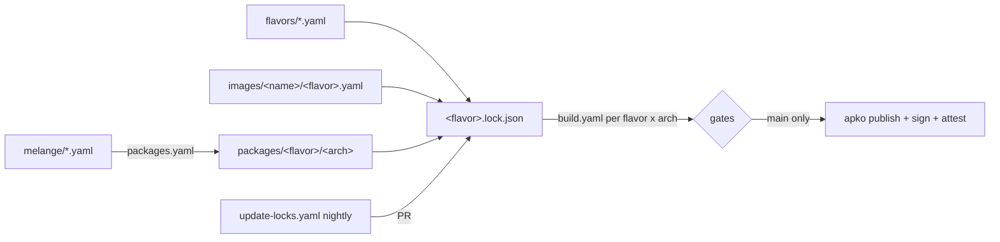

# hardened-images

Reproducible, signed, minimal container images. Every image ships in two
flavors built from the same definition style, for `amd64` and `arm64`:

| Flavor  | libc  | Distro            | Defined in            |
| ------- | ----- | ----------------- | --------------------- |
| `musl`  | musl  | Alpine Linux 3.23 | `flavors/musl.yaml`   |
| `glibc` | glibc | Wolfi             | `flavors/glibc.yaml`  |

Images are assembled with [apko](https://github.com/chainguard-dev/apko) from
signed packages; anything we patch or harden ourselves is built from source
with [melange](https://github.com/chainguard-dev/melange).

## Images

| Image      | Contents                                                        | Entrypoint      |
| ---------- | --------------------------------------------------------------- | --------------- |
| `base`     | libc, CA bundle, os-release. No shell, no package manager.      | none            |
| `balanced` | hardened busybox (no network daemons, no `su`/`login`, no suid) | `/bin/sh`       |
| `node24`   | Node.js 24 LTS runtime (no npm), CA bundle                      | `/usr/bin/node` |

All images run as `appuser` (uid/gid 1000).

```
ghcr.io/xilasec/<image>:<flavor>             # e.g. node24:musl, node24:glibc
ghcr.io/xilasec/<image>:<flavor>-YYYYMMDD    # publish date
```

Pin by digest in production; tags move when the image changes.

## Verifying an image

```sh
IMG=ghcr.io/xilasec/node24:musl
ID='https://github.com/xilasec/hardened-images/.github/workflows/build.yaml@refs/heads/main'
ISSUER=https://token.actions.githubusercontent.com

cosign verify "$IMG" --certificate-identity "$ID" --certificate-oidc-issuer "$ISSUER"
# SBOMs are attested per architecture manifest
AMD64=$(skopeo inspect --raw "docker://$IMG" \
  | jq -r '.manifests[] | select(.platform.architecture == "amd64") | .digest')
cosign verify-attestation "${IMG%:*}@$AMD64" --type spdxjson \
  --certificate-identity "$ID" --certificate-oidc-issuer "$ISSUER"
gh attestation verify "oci://$IMG" --repo xilasec/hardened-images     # SLSA provenance
```

Images that contain patched packages (`balanced`) also carry an OpenVEX
attestation (`--type openvex`).

## How it works



**Reproducible by construction.** Every image builds from a committed
lockfile pinning each package's version and checksum
(`images/<name>/<flavor>.lock.json`). The same lock produces the same digest;
CI proves it on every build by rebuilding with an empty cache
(`scripts/repro.sh`). Upstream trust anchors are vendored in `keys/`.

**Locally built packages** (`melange/`) are built once per version by
`.github/workflows/packages.yaml` on native runners, signed with the melange
key, attested, and committed to `packages/<flavor>/<arch>/`. A stamp file per
package records a hash of its recipe, patches and flavor repositories;
changing any of them without bumping `package.epoch` fails. Images request
them as `<name>@local`; a lock where such a package resolved to the upstream
build instead (apko does that silently when an arch is missing) is rejected.

**Gates** (`.github/workflows/build.yaml`, per image x flavor x arch):

1. flavor parity: every image must define both flavors (`scripts/matrix.sh`)
2. build from lock, then rebuild and compare digests
3. SBOM (syft)
4. grype on the SBOM and trivy on the image archive (independent catalogers),
   both applying the image's VEX statements (`vex/`)
5. OPA policy over both reports (`policies/vulnerability.rego`): Critical or
   fixable High fails; unfixed High warns
6. dockle CIS checks
7. functional test (`images/<name>/test.sh`), non-root check

**Publishing** (main only) uses `apko publish` from the same lock and refuses
to continue unless every pushed per-arch digest equals the tested one. It then
signs (keyless cosign), attests SBOMs/VEX, adds SLSA provenance, and only then
moves the `<flavor>` tag. If the registry already serves the tested digests,
nothing is pushed.

**Updates**: `update-locks.yaml` re-resolves all locks nightly and opens a PR;
merging it publishes the new images.

## Local use

Tools: `make tools` installs the pinned, checksum-verified versions (also
used by CI); `yq` (mikefarah) and `jq` are expected on the host. Building
packages needs `bubblewrap`.

```sh
make all IMAGE=node24 FLAVOR=musl              # build, repro, sbom, scan, verify, compliance, test
make all IMAGE=node24 FLAVOR=glibc ARCH=arm64  # foreign arch tests need binfmt/qemu
make every                                     # every image x flavor, host arch
make lock IMAGE=node24 FLAVOR=glibc            # refresh one lockfile
make packages FLAVOR=musl ARCH=x86_64          # rebuild stale melange packages
make policy-test                               # OPA policy unit tests
```

`DOCKER=...` selects the container CLI used by tests (default `docker`).

## Adding an image

1. `images/<name>/musl.yaml` and `images/<name>/glibc.yaml`, each starting
   with `include: flavors/<flavor>.yaml`.
2. `images/<name>/test.sh` exercising the image (`$DOCKER`, `$PLATFORM`).
3. `make lock IMAGE=<name> FLAVOR=musl` and `FLAVOR=glibc`.
4. Packages that need patching: `melange/<pkg>.yaml` (flavor-neutral; repos
   come from the flavor), request `<pkg>@local`, push the branch so
   `packages.yaml` builds and commits them, and add `vex/<pkg>.openvex.json`
   for CVEs the patches fix.
